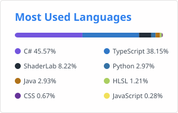

### Hi! I'm Jomity.

I'm a CS and math student at RIT, and I co-founded [Insidyr](https://github.com/insidyr-technologies). I'm most interested in backend work on distributed systems, and my favorite technologies are TypeScript, Node.js, C#, and everything coding! I have a lot of projects listed on my [website](https://jomity.net) and on [Khan Academy](https://www.khanacademy.org/profile/j0m1ty/projects).

...Loading other interests...

I lift, row, listen to a lot of [music](https://open.spotify.com/user/psbmkzrjh8ap9z2j0ioraesci), do competitive programming and math, and play chess in my free time.

You can find me at jomity@hotmail.com or as [jomity](https://discord.com/users/544963690185752576) on Discord. Challenge me at Beat Saber, I dare you!

-----

